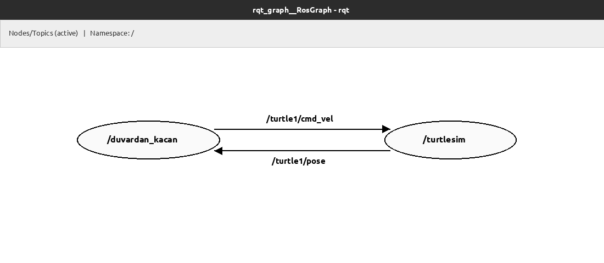
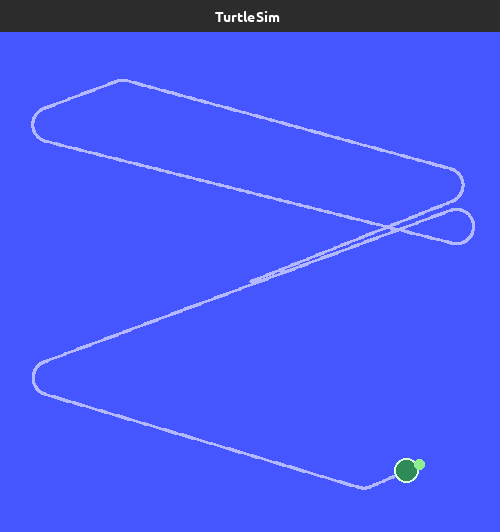
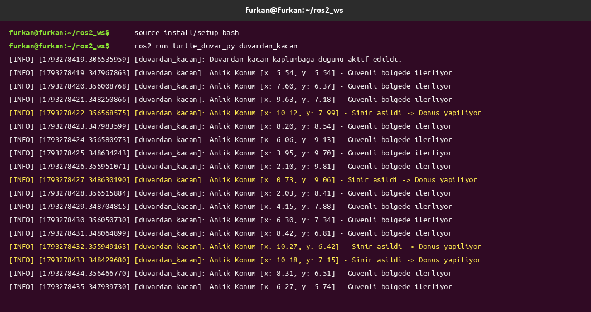

# Duvardan Kaçan Kaplumbağa (turtle_duvar_py)

**Hazırlayan:** Furkan Ortatepe  
**Altyapı:** ROS 2 Humble / Python 3 (`rclpy`)

---

## 1. Projenin Amacı ve Gerçek Hayattaki Karşılığı

Bu çalışmada, ROS 2 üzerindeki `turtlesim` simülasyon ortamında hareket eden bir kaplumbağanın kendi konumunu sürekli takip ederek pencere sınırlarına (duvarlara) çarpmadan otonom şekilde yön değiştirmesi amaçlanmıştır.

### Sıfırdan Başlayanlar İçin: Bu Sistem Gerçek Hayatta Nasıl Kullanılır?

Simülasyon ekranında gördüğümüz kaplumbağayı, evlerimizde çalışan **akıllı bir robot süpürge** ya da bir fabrikada yük taşıyan **otonom mobil robot (AMR)** olarak düşünebiliriz:

1. **Konum Okuma (Sensör / Odometri - Abone):** Gerçek bir robot, tekerleklerindeki enkoderlerden, LiDAR sensöründen veya iç mekan konumlandırma sisteminden odanın neresinde olduğunu (`x` ve `y` koordinatlarını) sürekli okur. Bizim projemizde bu görevi `/turtle1/pose` konusunu (topic) dinleyen **Subscriber (Abone)** üstlenir.
2. **Güvenlik Sınırı (Sanal Duvar / Geofencing):** Gerçek robotların fiziksel duvara sıfır noktada çarpması istenmez; duvara belirli bir mesafe kala (örneğin 1 metre kala) "güvenlik sınırı" tanımlanır. Simülasyon ekranımız `0.0` ile `11.0` birim genişliğindedir. Bu yüzden `1.0` ve `10.0` değerlerini sanal güvenlik sınırı olarak belirledik.
3. **Motor Kontrolü (Karar ve Hareket - Yayıncı):** Robot güvenli bölgedeyken motorlarına sadece ileri gitme komutu verilir. Ancak sensörden gelen `x` veya `y` verisi `1.0`'ın altına düşerse ya da `10.0`'ın üzerine çıkarsa, kontrolcü duvara yaklaşıldığını anlar; ileri hızı düşürüp dönüş (açısal hız) komutu göndererek robotu tekrar güvenli bölgeye çevirir. Projemizde bu komutu `/turtle1/cmd_vel` konusuna gönderen **Publisher (Yayıncı)** gerçekleştirir.

---

## 2. Sistemin Çalışma Mantığı (Kapalı Çevrim Kontrol)

Projede iki düğüm (node) birbiriyle sürekli konuşur:

- **`/turtlesim` düğümü:** Simülasyonun kendisidir. Kaplumbağanın anlık koordinatlarını `/turtle1/pose` üzerinden yayınlar ve `/turtle1/cmd_vel` üzerinden gelen hız komutlarını uygular.
- **`/duvardan_kacan` düğümü:** Bizim yazdığımız kontrol düğümüdür. Konumu dinler, sınır kontrolü yapar, hız komutunu üretir ve saniyede bir kez terminale durum raporu (log) basar.

### Düğüm ve Konu İletişim Grafiği (`rqt_graph`)

Aşağıdaki `rqt_graph` çıktısında görüldüğü gibi, `/turtlesim` düğümünden çıkan `/turtle1/pose` verisi `/duvardan_kacan` düğümüne girer; işlenen karar ise `/turtle1/cmd_vel` konusu üzerinden tekrar `/turtlesim` düğümüne iletilir:



---

## 3. Kodun ve Paket Yapısının İncelenmesi

Paket içerisinde yer alan dosyalar ve görevleri şu şekildedir:

```text
turtle_duvar_py/
├── package.xml                  # Paket bağımlılıkları (rclpy, geometry_msgs, turtlesim)
├── setup.py                     # Düğümün (duvardan_kacan) çalıştırılabilir giriş noktası
├── setup.cfg                    # ROS 2 paket kurulum dizini ayarı
├── README.md                    # Proje anlatımı ve test çıktıları
└── turtle_duvar_py/
    ├── __init__.py
    └── duvardan_kacan.py        # Ana kontrol düğümü kaynak kodu
```

### `duvardan_kacan.py` İçerisinde Neler Yapılıyor?

1. **Parametre Tanımlama (Bonus Özellik):**
   Sabit sayılar kullanmak yerine hız ve duvar sınırları `declare_parameter` ile tanımlanmıştır:
   - `linear_speed` (Varsayılan: `2.2`): Düz giderken uygulanan doğrusal hız.
   - `angular_speed` (Varsayılan: `2.6`): Duvara yaklaşınca uygulanan dönüş hızı.
   - `min_limit` (Varsayılan: `1.0`): Sol ve alt kenar için kaçış sınırı.
   - `max_limit` (Varsayılan: `10.0`): Sağ ve üst kenar için kaçış sınırı.

2. **Abone ve Yayıncı Döngüsü (`pose_callback`):**
   `/turtle1/pose` konusundan her konum mesajı geldiğinde `msg.x` ve `msg.y` kontrol edilir. Eğer kaplumbağa `[1.0, 10.0]` aralığının dışına çıkmışsa ileri hız yavaşlatılır (`linear_speed * 0.45`) ve `cmd.angular.z = angular_speed` verilerek kavisli bir dönüşle duvardan uzaklaştırılır.

3. **Zamanlayıcı ile Loglama (`log_timer_callback`):**
   `create_timer(1.0, ...)` kullanılarak her 1 saniyede bir `get_logger().info()` çağrılır. Böylece terminal ekranı saniyede onlarca mesajla dolmak yerine, her saniye düzenli olarak kaplumbağanın koordinatını ve o anki durumunu (`Guvenli bolgede ilerliyor` veya `Sinir asildi -> Donus yapiliyor`) gösterir.

---

## 4. Uygulama ve Test Ekran Görüntüleri

### Simülasyon Testi (`turtlesim_ekran.png`)

Düğüm çalıştırıldığında kaplumbağa merkezden (`x: 5.54, y: 5.54`) harekete başlamış, sağ sınıra (`x > 10.0`) ulaştığında yumuşak bir dönüş yaparak sol üst sınıra yönelmiş, ardından sol duvardan (`x < 1.0`) ve alt duvardan (`y < 1.0`) kaçarak duvarlara hiç çarpmadan hareketini sürdürmüştür:



### Terminal Log Çıktısı (`terminal_log.png`)

Aşağıdaki terminal çıktısında saniyede bir yazdırılan konum değerleri görülmektedir. Örneğin;
- İlk saniyelerde kaplumbağa `x: 5.54 -> 7.60 -> 9.63` şeklinde güvenli bölgede ilerlemektedir.
- `x: 10.12, y: 7.99` koordinatına ulaştığı saniyede `max_limit` (`10.0`) aşıldığı için düğüm **`Sinir asildi -> Donus yapiliyor`** durumuna geçmiş ve kaplumbağayı döndürerek tekrar `x: 8.20` ile güvenli bölgeye sokmuştur.
- Benzer şekilde sol kenarda `x: 0.73, y: 9.06` değerine düştüğünde `min_limit` (`1.0`) altına indiği için tekrar dönüş manevrası yapmıştır.



---

## 5. Kurulum ve Çalıştırma Adımları

Paketi kendi bilgisayarınızda sıfırdan derleyip denemek için aşağıdaki adımları sırasıyla uygulayabilirsiniz:

### Adım 1: Paketi Çalışma Alanına İndirme ve Derleme

```bash
mkdir -p ~/ros2_ws/src
cd ~/ros2_ws/src
git clone https://github.com/furkanortatepe/turtle_duvar_py.git
cd ~/ros2_ws
colcon build --packages-select turtle_duvar_py
source install/setup.bash
```

### Adım 2: Simülasyonu Başlatma (1. Terminal)

```bash
source /opt/ros/humble/setup.bash
ros2 run turtlesim turtlesim_node
```

### Adım 3: Kontrol Düğümünü Başlatma (2. Terminal)

```bash
source /opt/ros/humble/setup.bash
source ~/ros2_ws/install/setup.bash
ros2 run turtle_duvar_py duvardan_kacan
```

### Adım 4 (Bonus): Parametreleri Dışarıdan Değiştirerek Çalıştırma

Kodun içine müdahale etmeden, terminal üzerinden hızı veya duvar sınırlarını değiştirmek isterseniz `--ros-args -p` yapısını kullanabilirsiniz. Örneğin kaplumbağayı daha hızlı sürmek ve duvarlardan daha erken (`1.5` ile `9.5` arasında) kaçmasını sağlamak için:

```bash
ros2 run turtle_duvar_py duvardan_kacan --ros-args -p linear_speed:=3.0 -p angular_speed:=3.2 -p min_limit:=1.5 -p max_limit:=9.5
```
