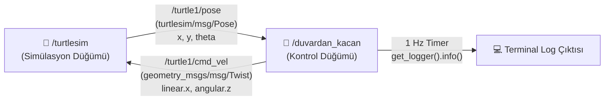

# 🐢 Duvardan Kaçan Kaplumbağa (`turtle_duvar_py`)

<p align="center">
  
  
  
  
</p>

**Geliştirici:** Furkan Ortatepe ([@furkanortatepe](https://github.com/furkanortatepe))

Bu proje, **ROS 2 (Humble)** üzerinde `turtlesim` simülasyonundaki kaplumbağanın duvarlara çarpmadan otonom olarak gezinmesini sağlayan bir Python paketidir (`turtle_duvar_py`).

---

## 📋 Ödev Gereksinimleri ve Karşılanan Özellikler

1. **Paket (`turtle_duvar_py`)**: `rclpy`, `geometry_msgs` ve `turtlesim` bağımlılıklarıyla oluşturulmuştur.
2. **Abone (`Subscriber`)**: `/turtle1/pose` (`turtlesim/msg/Pose`) konusunu dinleyerek kaplumbağanın anlık `x` ve `y` koordinatlarını alır.
3. **Yayıncı (`Publisher`)**: `/turtle1/cmd_vel` (`geometry_msgs/msg/Twist`) konusuna hız komutları gönderir. `x` veya `y` değeri `1.0`'dan küçük ya da `10.0`'dan büyük olduğunda kaplumbağa dönerek yön değiştirir ve duvardan uzaklaşır.
4. **Log (`get_logger().info()`)**: Saniyede bir kez (`1.0` sn periyotlu timer ile) kaplumbağanın anlık konumunu ve durumunu terminale yazdırır.
5. **Bonus (Parametreler)**: İleri hız (`linear_speed`), dönüş hızı (`angular_speed`), alt sınır (`min_limit`) ve üst sınır (`max_limit`) değerleri ROS 2 parametresi olarak tanımlanmıştır ve çalışma anında değiştirilebilir.

---

## 🧩 Sistem Mimarisi ve Veri Akış Diyagramı



---

## 📂 Paket Dosya Yapısı

```text
turtle_duvar_py/
├── package.xml                  # Paket bilgileri ve bağımlılıklar (rclpy, geometry_msgs, turtlesim)
├── setup.py                     # Python paket kurulumu ve entry_points tanımı
├── setup.cfg                    # Script kurulum dizini yapılandırması
├── README.md                    # Proje dokümantasyonu ve ekran görüntüleri
├── turtlesim_ekran.png          # Turtlesim simülasyon ekran görüntüsü
├── terminal_log.png             # Terminal log çıktısı ekran görüntüsü
├── rqt_graph.png                # Düğüm ve konu bağlantıları (rqt_graph)
├── resource/
│   └── turtle_duvar_py
└── turtle_duvar_py/
    ├── __init__.py
    └── duvardan_kacan.py        # Duvardan kaçan kaplumbağa ROS 2 düğümü
```

---

## 🚀 Kurulum ve Çalıştırma

### 1. Paketi Derleme

```bash
cd ~/ros2_ws/src
git clone https://github.com/furkanortatepe/turtle_duvar_py.git
cd ~/ros2_ws
colcon build --packages-select turtle_duvar_py
source install/setup.bash
```

### 2. Turtlesim Simülasyonunu Başlatma (1. Terminal)

```bash
source /opt/ros/humble/setup.bash
ros2 run turtlesim turtlesim_node
```

### 3. Duvardan Kaçan Kaplumbağa Düğümünü Başlatma (2. Terminal)

```bash
source /opt/ros/humble/setup.bash
source ~/ros2_ws/install/setup.bash
ros2 run turtle_duvar_py duvardan_kacan
```

---

## ⭐ Bonus: Parametrelerle Çalıştırma

Düğüm içerisinde tanımlanan ROS 2 parametreleri:

| Parametre Adı | Varsayılan Değer | Açıklama |
| :--- | :---: | :--- |
| `linear_speed` | `2.0` | Kaplumbağanın doğrusal ileri hızı (`m/s`) |
| `angular_speed` | `2.5` | Sınıra yaklaştığında dönüş açısal hızı (`rad/s`) |
| `min_limit` | `1.0` | Alt duvar güvenlik sınırı (`x < min_limit` veya `y < min_limit`) |
| `max_limit` | `10.0` | Üst duvar güvenlik sınırı (`x > max_limit` veya `y > max_limit`) |

Farklı hız ve sınır değerleriyle çalıştırmak için:

```bash
ros2 run turtle_duvar_py duvardan_kacan --ros-args -p linear_speed:=3.0 -p angular_speed:=3.0 -p min_limit:=1.5 -p max_limit:=9.5
```

---

## 📸 Ekran Görüntüleri

### 1. Turtlesim Duvardan Kaçış Simülasyonu
Kaplumbağa `1.0` ve `10.0` sınırlarına ulaştığında otomatik olarak dönerek duvarlardan kaçmaktadır:

<p align="center">
  
</p>

### 2. Terminal Log Çıktısı (Saniyede Bir Konum Bilgisi)
`get_logger().info()` ile her saniye kaplumbağanın `x` ve `y` koordinatları terminale yazdırılmaktadır:

<p align="center">
  
</p>

### 3. Düğüm ve Konu Grafiği (`rqt_graph`)
`/duvardan_kacan` ve `/turtlesim` düğümleri arasındaki `/turtle1/pose` ve `/turtle1/cmd_vel` haberleşmesi:

<p align="center">
  
</p>
